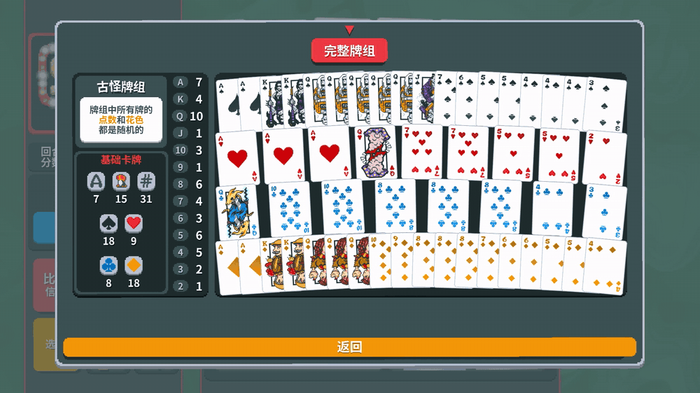
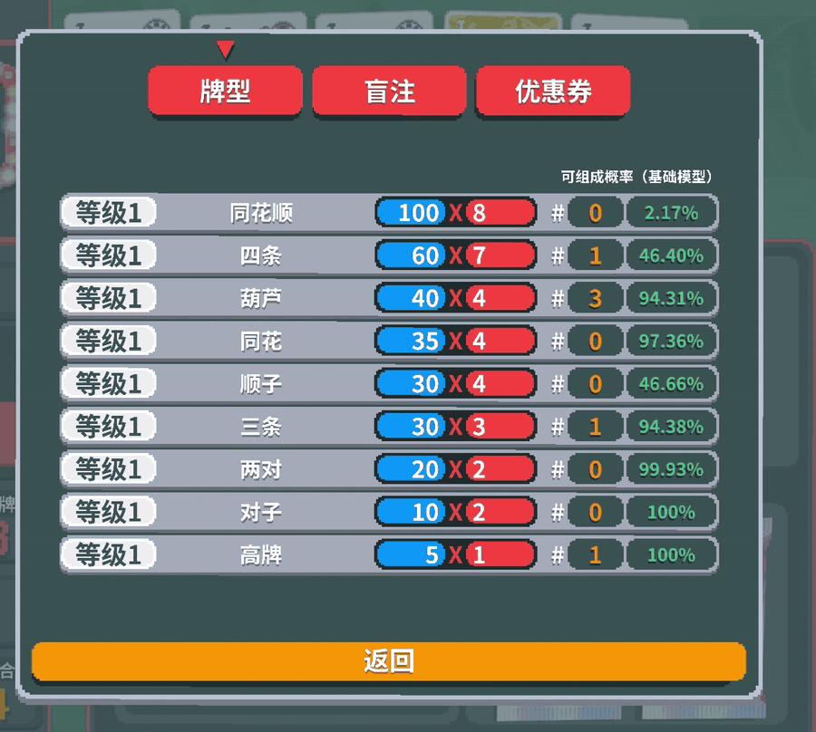
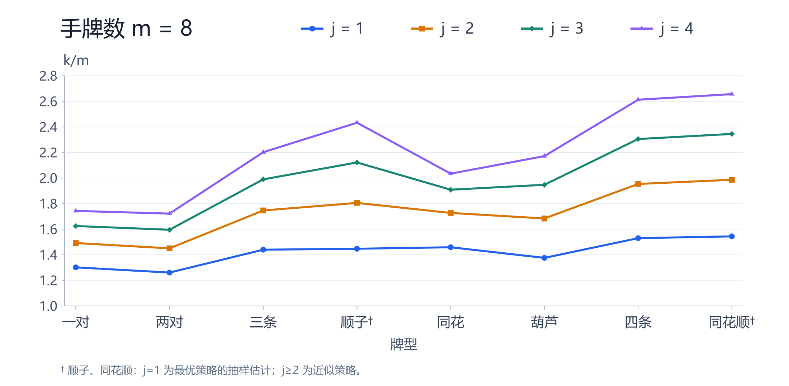

# Balatro 数值分析

围绕《小丑牌》（Balatro）的三组数值工作：一个已发布使用的游戏内 Mod、一套精确概率参考实现，以及一个最优弃牌与等效抓牌张数的研究项目。所有概率均为组合计数的精确结果，不使用蒙特卡洛近似（顺子类弃牌策略除外，下文单独标注）。

## 目录

- [游戏内 Mod](#游戏内-mod)
- [Python 精确参考实现](#python-精确参考实现)
- [最优弃牌与等效抓牌张数](#最优弃牌与等效抓牌张数)
- [复现](#复现)
- [仓库结构](#仓库结构)
- [数据与免责声明](#数据与免责声明)

## 游戏内 Mod

[HandProbabilities](HandProbabilities) 是一个 Lovely 加载的 Balatro Mod，不依赖 Steamodded。它在牌型面板右侧增加一列「可组成概率」，并在小丑悬浮提示里显示该小丑对每种牌型的期望收益。

| 古怪牌组与牌型构成 | 牌型概率列 |
|---|---|
|  |  |

| 微笑表情（人头牌 +5 倍率） | 暴食小丑（梅花 +3 倍率） |
|---|---|
|  |  |

实现要点：

- 牌型概率覆盖 12 类，取抽牌张数 `k = min(n, ceil(1.8m))`，n 为牌组剩余张数，m 为手牌上限，对应考虑弃牌机会的简化模型。
- 计算核心是组合计数 DP，状态压缩为点数状态、顺子窗口位掩码与花色并集，全部精确求解。
- 小丑收益按加法 `P(T)·E[N|T]·系数` 与乘法 `1+ΣP(T且N=n)(Xⁿ−1)` 两类展开，含目标交集与多花色联合条件。
- 概率与小丑收益在 `love.thread` 后台线程计算，不消耗游戏随机数；缓存键包含牌组、手牌上限、小丑实例与概率系数。
- 35 张小丑的规格来自 [joker_catalog.json](HandProbabilities/joker_catalog.json)，构建时静态嵌入 Lua，以便在工作线程中执行。

安装需要 Lovely 0.10.0。把 [Lovely 发布页](https://github.com/ethangreen-dev/lovely-injector/releases/tag/v0.10.0) 的 `winmm.dll` 放到 `Balatro.exe` 同目录，再把 `HandProbabilities` 文件夹放入 `%APPDATA%\Balatro\Mods\`。完整口径与公式见 [Mod README](HandProbabilities/README.md) 与 [JOKER_F.md](HandProbabilities/JOKER_F.md)。

## Python 精确参考实现

[python-reference](python-reference) 是 Mod 的数学原型与验证 oracle，全程使用 `fractions.Fraction`。

- [hand_type_probs.py](python-reference/hand_type_probs.py) 对子族同时给出「包含」与「恰好」两套口径，同花为「至少一花色 ≥5」的 DP，顺子用 `(t, run, st, ace)` 扫描并特判 TJQKA，同花顺用花色主序联合 DP。
- [card_type_probs.py](python-reference/card_type_probs.py) 输出 10 类牌型的逐格参与概率矩阵 `P(能打出包含该格的牌型)`。
- [card_type_expectations.py](python-reference/card_type_expectations.py) 输出条件期望、无条件期望与分组数组，定义各牌型张数上限与 `for_hand_limit`。
- [grouped_expectations.py](python-reference/grouped_expectations.py) 按整花色/整点数重新选最优核心，避免「各格最大值相加」的组合错误。

[tests/verify_mod.py](python-reference/tests/verify_mod.py) 在游戏真实的 LuaJIT DLL 中执行 Mod 的计算核心，与 Python 的精确算术逐项对照，并用独立的合法核心枚举校验条件期望；覆盖标准 52 张、A2345、TJQKA、禁止 KA234 回绕、重复格、空牌组与自定义小牌组。

## 最优弃牌与等效抓牌张数

[discard-analysis](discard-analysis) 回答一个独立问题：标准 52 张、弃牌不回牌堆、每次可弃 0–5 张并补满，允许最优弃牌时，**一次成牌相当于直接多抓几张牌**。

一对、两对、三条、同花、葫芦、四条共 120 项使用精确最优 DP；顺子与同花顺 40 项使用 20 万样本评估，`j=1` 的策略严格最优，`j≥2` 为经过策略比较的可行近似。

| m | j | 一对 | 两对 | 三条 | 顺子† | 同花 | 葫芦 | 四条 | 同花顺† |
|---|---|---|---|---|---|---|---|---|---|
| 6 | 1 | 7.96 | 7.52 | 8.91 | 8.37 | 8.76 | 7.90 | 9.35 | 9.04 |
| 8 | 1 | 10.41 | 10.09 | 11.52 | 11.58 | 11.67 | 11.01 | 12.24 | 12.35 |
| 10 | 1 | 12.55 | 12.50 | 13.83 | 14.18 | 13.49 | 13.68 | 14.53 | 14.62 |
| 10 | 4 | 14.00 | 16.59 | 20.48 | 25.19 | 16.96 | 20.48 | 23.90 | 24.45 |

† 含抽样误差，95% 区间半宽约 0.009–0.069 张。



完整 160 项结果、实际成牌概率与抽样区间见 [report.md](discard-analysis/report.md)，逐项记录见 [results.json](discard-analysis/results.json)。

方法要点：

- 对子族按「(已持, 剩余)」点数类型压缩状态，枚举弃法与补牌计数，末轮用 `(抽数, ≥2, ≥3, ≥4 点数)` 三维 DP 解析积分。
- 同花按各花色已持/剩余计数压缩，末轮用容斥扣除两组不交同花。
- 顺子与同花顺用 10 个窗口的容斥计算单次弃牌成功率，多轮使用前瞻代理策略并单独积分最后一轮。
- 精确递推与独立实体牌枚举对照，覆盖两轮弃牌及弃牌不放回。

## 复现

Python 部分只需标准库。

```bash
python python-reference/card_type_expectations.py
```

Mod 对照测试需要正版游戏提供的 LuaJIT 运行库，通过环境变量指定。

```bash
set BALATRO_LUA51=D:\Steam\steamapps\common\Balatro\lua51.dll
python python-reference/tests/verify_mod.py
```

弃牌分析需要 .NET 8 与 Python 3。

```bash
python discard-analysis/baselines.py
dotnet run --project discard-analysis -- pair 4
dotnet run --project discard-analysis -- flush 4
dotnet run --project discard-analysis -- rank 0
dotnet run --project discard-analysis -- simulate straight
python discard-analysis/export_results.py
python discard-analysis/plot_ratios.py
node discard-analysis/render_charts.cjs   # 需要 npm i sharp
```

## 仓库结构

```
.
├─ HandProbabilities/       游戏内 Mod（Lua，Lovely 加载）
│  ├─ main.lua / probability.lua / jokers.lua / joint_suits.lua
│  ├─ joker_tooltip.lua / lovely.toml / joker_catalog.json
│  └─ gifs/                 README 用演示动图
├─ python-reference/        精确概率参考实现与对照测试
├─ discard-analysis/        C# 弃牌 DP、Python 基准与图表、报告
└─ NOTICE
```

## 数据与免责声明

本仓库只包含自行编写的代码、分析与演示动图，不包含 Balatro 的游戏程序、美术资源或原始数据表。运行对照测试需要用户自备正版游戏。项目为非官方粉丝作品，与 LocalThunk、Playstack 无关联。

## 局限

- Mod 采用 `k = ceil(1.8m)` 的简化抽牌模型，不对已知手牌做条件化，也不模拟四指、捷径、四色合一、百搭与石头牌等特殊规则。
- 弃牌分析中顺子与同花顺的多轮策略未证明全局最优，点估计另含抽样误差。
- `k` 在相邻整数抽牌数之间线性插值，不是累计见过的牌数。
